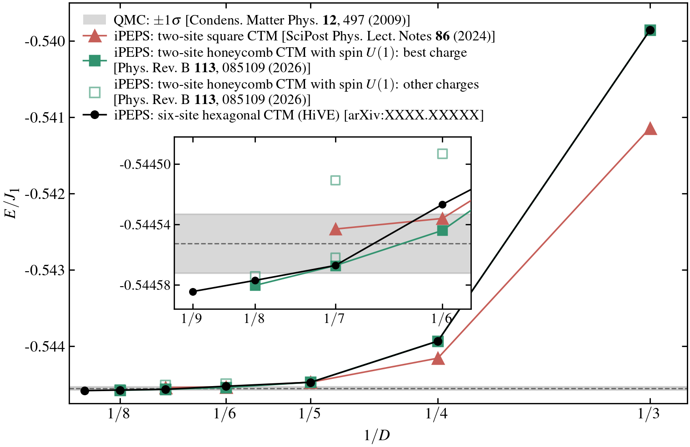

# Honeycomb Heisenberg benchmark

The spin-1/2 nearest-neighbor antiferromagnet has `J1=1`, `J2=0` and no
pinning field. The figure compares finite-D energies per
site. Black circles and their connecting line are HiVE Neel-ansatz results
at D=3--9. The inset enlarges the high-D observations. The gray band is the
one-sigma QMC interval, `E/J1 = -0.5445525 +/- 0.0000195`.



The three iPEPS calculations use different CTM environments for the same
honeycomb Hamiltonian. Red triangles use a **two-site square CTM**, with
two spins blocked into each square-network tensor. Green squares use a
**two-site honeycomb CTM with spin U(1)** and C3v lattice symmetry.
Filled squares show the best charge choice at each D; open squares show
other virtual U(1) charge allocations among the D bond states.

HiVE uses a **six-site hexagonal CTM** without imposing spin U(1).
Its six-site cell accommodates both plaquette and columnar-dimer bond
patterns. The present Neel ansatz symmetrizes the three virtual legs.
All three methods optimize iPEPS tensors by automatic differentiation.

The comparison values are tabulated in [quoted_energies.csv](quoted_energies.csv):

- QMC: U. Löw, *Condensed Matter Physics* **12**, 497--506 (2009),
  [doi:10.5488/CMP.12.3.497](https://doi.org/10.5488/CMP.12.3.497).
  The body reports `-0.363035(13)` per bond; multiply by 3/2 for the energy
  and uncertainty per site.
- Two-site honeycomb CTM with spin U(1): Q. Yang and P. Corboz, *Physical Review B* **113**,
  085109 (2026), [doi:10.1103/9gmp-byx8](https://doi.org/10.1103/9gmp-byx8).
  Values are from Table I of [arXiv:2509.05090](https://arxiv.org/abs/2509.05090).
- Two-site square CTM: J. Naumann et al., *SciPost Physics Lecture Notes*
  **86** (2024), [doi:10.21468/SciPostPhysLectNotes.86](https://doi.org/10.21468/SciPostPhysLectNotes.86).
  Values are the variational-update column of the table below Fig. 29.

`D_3/` through `D_10/` contain optimized Neel states and measurements.
The D=3 state is optimized with HiVE at chi=27; its optimization settings
and three-chi energy check are stored in `metadata.json`.

Reproduce this small-D state from the HiVE directory with:

```sh
python examples/optimize.py --ansatz 3legSymmetrized1tensor --D 3 --chi 27 --steps 80 --ctm-steps 80 --seed 7 --output output/benchmark_D3
```

| File | Contents |
| --- | --- |
| `tensor.npz` | Real tensor parameters in HiVE's portable format. |
| `metadata.json` | D, chi, couplings, tensor axes, dtype and source-content hashes. |
| `observables.json` | Energy per site and per six-site cell, local spin components, all bond correlations, staggered moment and inverse correlation length. |
| `observables_chi_*.txt` | Full measurements at the stated environment dimensions, including the existing lookahead evaluation. |
| `correlation_length.json` | Three ordinary transfer spectra, directional correlation lengths and CTMRG parameters. |

The tensor axes are `(virtual_1, virtual_2, virtual_3, spin)` with shape
`(D,D,D,2)`. The ansatz is `3legSymmetrized1tensor`: HiVE averages over all
six virtual-leg permutations and generates the opposite sublattice by a
pi rotation about y. `env1`, `env2`, `env3` distinguish the translated
environments; letters A--F label sites of the six-site hexagon.
`C_ij = <Si.Sj>` is dimensionless. `m` is the staggered moment per spin;
`inverse_xi` is the mean directional log transfer-eigenvalue ratio.
Their numerical errors retain the RMS-spread definitions of the measurements.
The directional spectra and individual spin/bond measurements are also retained.
`energy` is the energy of the six-site cell and `energy_per_site=energy/6`.
Within each environment the six NN pairs are:

| Environment | NN pairs |
| --- | --- |
| `env1` | EB, AD, CF, FA, DE, BC |
| `env2` | CB, AF, ED, DC, BA, FE |
| `env3` | EF, AB, CD, BE, FC, DA |

The remaining pairs are next-nearest neighbors. `site_spins` gives the three
Cartesian components of each local spin expectation value. The directional
transfer eigenvalues determine `xi = 1/log(abs(lambda_1/lambda_2))`.

From the directory containing `pyproject.toml`, an existing state can be measured with:

```sh
python examples/evaluate.py benchmark/D_4/tensor.npz --output output/benchmark_D4_observables.json
python examples/correlation_length.py benchmark/D_4/tensor.npz --output output/benchmark_D4_correlation_length.json
```

To redraw the comparison, install Matplotlib alongside HiVE's dependencies
and use a LaTeX installation with the packages specified in `publication.mplstyle`:

```sh
python benchmark/build_benchmark.py
```

The script reads only this folder and writes `benchmark.png`.
No optimization or extrapolation is run. The HiVE arXiv
identifier in the legend is a placeholder until the paper is available.
